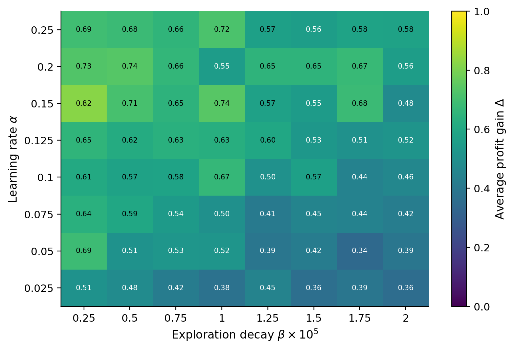
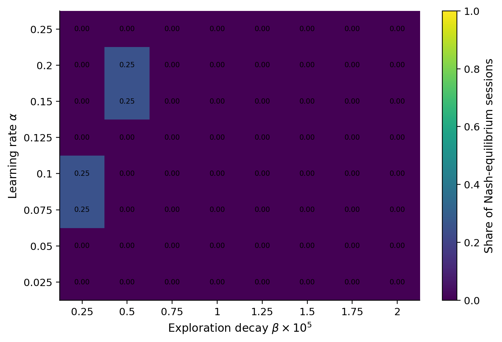
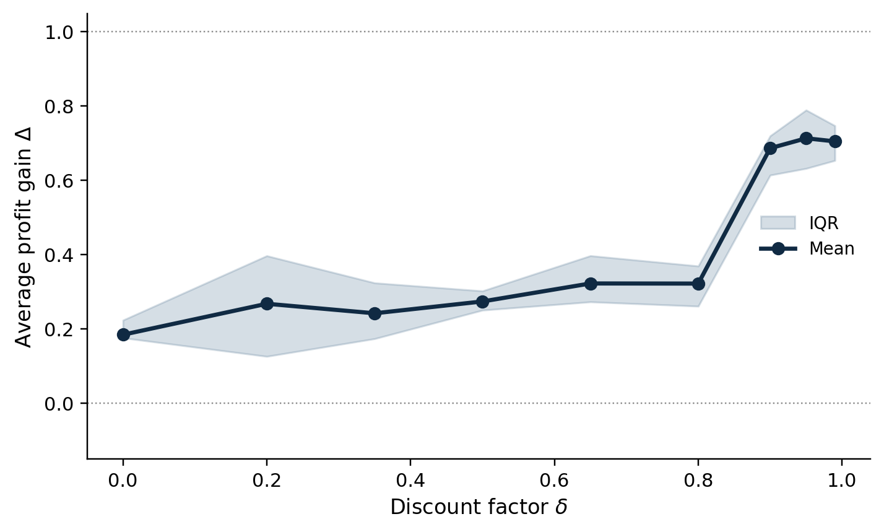
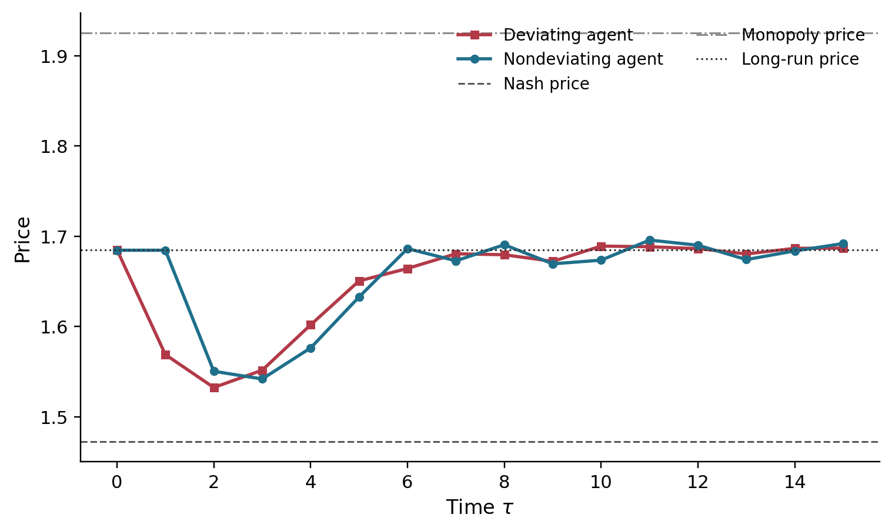
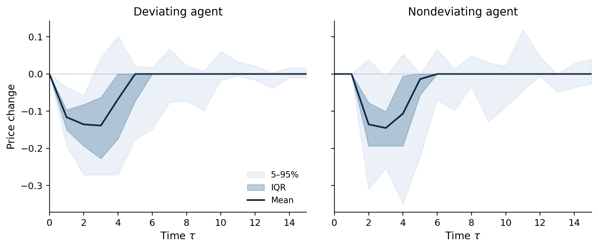
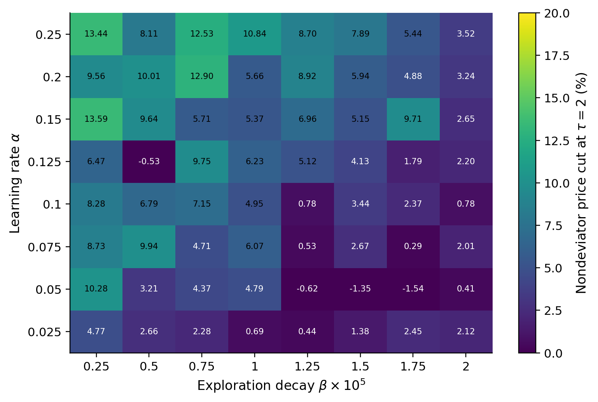
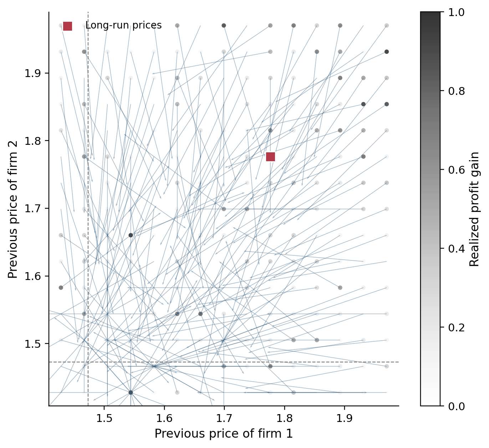
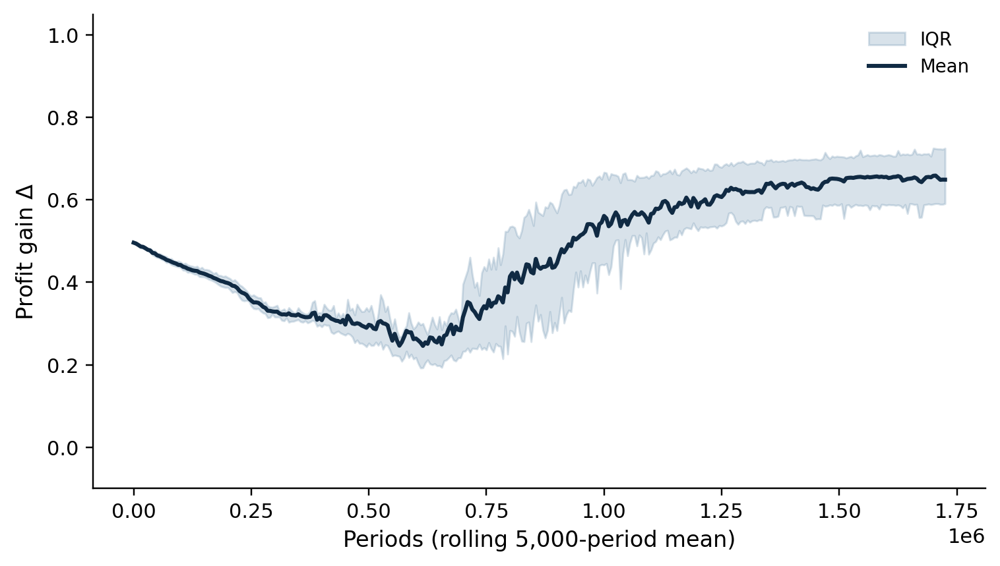
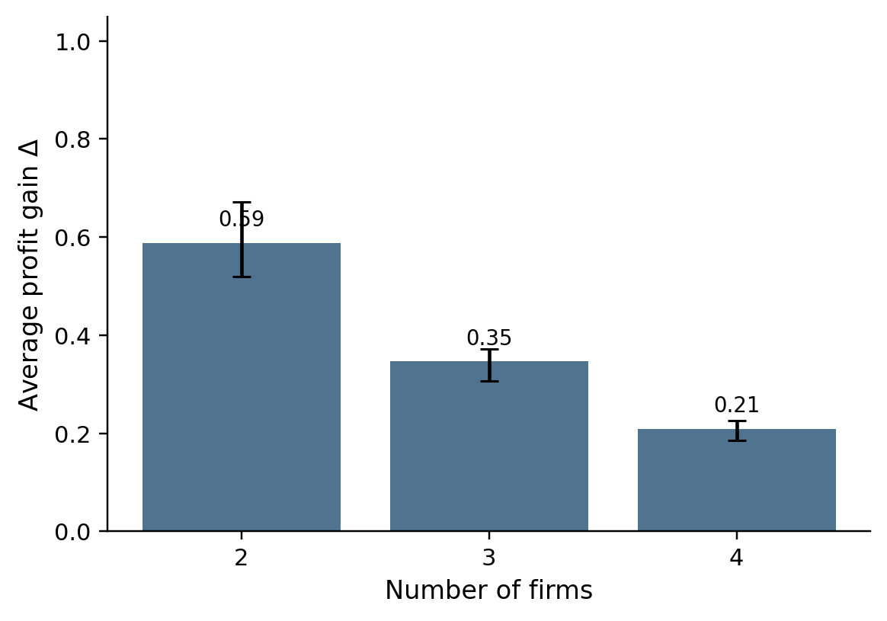

# T3 论文复现报告：Artificial Intelligence, Algorithmic Pricing, and Collusion

> **论文**：Emilio Calvano, Giacomo Calzolari, Vincenzo Denicolò, Sergio Pastorello  
> **题目**：Artificial Intelligence, Algorithmic Pricing, and Collusion  
> **期刊**：*American Economic Review*, 2020, 110(10): 3267–3297  
> **DOI**：[10.1257/aer.20190623](https://doi.org/10.1257/aer.20190623)  
> **官方复现数据 DOI**：[10.3886/E119462V1](https://doi.org/10.3886/E119462V1)  
> **复现日期**：2026-10-20  
> **复现材料**：`T3-Artificial intelligence algorithmic pricing, and collusion.pdf`  
> **代码与结果**：`t3_replication/`

---

## 摘要

本文研究独立学习的定价算法是否会“自主”学会默契合谋。四个厂商并非关键，论文的基准市场是两个销售差异化产品、每期同时定价的厂商。每个厂商使用一个独立的 Q-learning 算法，只观察自己和对手的历史价格与利润，不交流，也不知道需求函数。论文发现：算法会系统性地学习到高于静态 Bertrand-Nash 价格、低于或接近垄断价格的定价水平；这种高价格不是单纯的学习失败，而是由“偏离—惩罚—逐步恢复合作”的策略维持。

本次复现按照论文公式重建了完整的 Q-learning 寡头模拟器，并生成了利润增益网格、均衡率网格、贴现因子曲线、偏离脉冲响应、惩罚强度网格、策略相图和进入学习阶段的过渡图。核心结论是：

1. **模型校准与算法结构复现程度较高**。在论文基准参数下，程序计算得到静态 Nash 价格 $p^N=1.4729$、垄断价格 $p^M=1.9250$，价格网格为 $[1.4277,1.9702]$；价格成本加成从 Nash 到垄断放大约 **1.956 倍**，与论文所称“约两倍”一致。
2. **论文的定性结论在缩减规模实验中成立**。代表性实验（30 个会话）的平均利润增益为 **0.645**；相对 Nash 价格的平均长期价格提高了约 **14.4%**。83.3% 的会话中，非偏离厂商在偏离后的第 2 期降价；平均降幅为 **7.77%**，价格中位数在偏离后 **5 期**恢复到长期水平 1% 以内。
3. **参数网格和稳健性实验的方向与论文一致**。8×8 网格的平均利润增益为 **0.557**，单元均值为 **0.342–0.821**；利润增益与惩罚强度的相关系数为 **0.598**。厂商数从 2 增至 3、4 时，平均利润增益从 **0.589** 降至 **0.347**、**0.209**。
4. **原论文的数值水平没有被精确复现**。论文报告基准利润增益约为 **70%–90%**、代表性实验中约一半会话在路径上达到纳什均衡；本次缩减实验的平均利润增益为 **64.5%**，路径均衡率仅 **3.3%**，Q-loss 也明显更高。因此，本报告更准确的定位是：**机制复现成功，数值复现有限**。

> **复现结论一句话**：本复现支持“独立 Q-learning 定价算法会学习高价格，并通过有限期惩罚维持合作”的核心机制，但不能声称已经逐位复刻原论文的 100×100×1,000 会话结果。

---

## 1. 论文研究问题

### 1.1 现实背景

论文写于算法定价快速普及的时期。传统定价软件主要执行人工设定的规则，而强化学习算法可以从试错中自行形成策略。若多个厂商各自部署独立的强化学习定价程序，即使程序之间没有通信，也可能在重复竞争中发现“抬高价格—惩罚降价—恢复合作”的策略。

这带来两个不同的问题：

1. **结果问题**：算法是否会把价格抬高？
2. **机制问题**：高价是否由策略性惩罚维持，还是仅仅因为算法没有学会竞争？

论文特别强调第二个问题。单看高价不能证明合谋；若算法只是学得不好，高价并不构成经济学意义上的默契合谋。论文因此不仅统计价格，还检验：

- 算法是否收敛到稳定策略；
- 收敛策略是否接近对竞争对手策略的最佳反应；
- 单方面降价是否会在后续被惩罚；
- 惩罚是否有限期、是否最终恢复合作。

### 1.2 核心发现

论文的主要结论是：

- 在对称双寡头基准环境中，Q-learning 算法系统地学习到 **70%–90% 的利润增益**；
- 算法很少学习“永久价格战”式的 Grim Trigger，而是学习 **有限期惩罚后逐步恢复合作** 的策略；
- 随着厂商数量增加，合谋程度下降，但三厂商和四厂商市场仍存在显著高于 Nash 的价格；
- 成本或需求不对称、随机需求、厂商进出等环境变化不会消除合谋；
- 算法需要数十万到数百万期才能收敛，但高价格在收敛前就已出现。

---

## 2. 论文模型

### 2.1 Logit 寡头需求

市场中有 $n$ 个差异化产品和一个外部商品。厂商 $i$ 在第 $t$ 期的需求为

$$
q_{i,t}
=
\frac{
\exp\left(\frac{a_i-p_{i,t}}{\mu}\right)
}{
\sum_{j=1}^{n}\exp\left(\frac{a_j-p_{j,t}}{\mu}\right)
+
\exp\left(\frac{a_0}{\mu}\right)
},
$$

其中：

- $p_{i,t}$：厂商 $i$ 的价格；
- $a_i$：产品质量指数；
- $a_0$：外部商品质量指数，也控制市场总需求；
- $\mu$：产品差异化程度；$\mu\to0$ 时产品趋近完全替代；
- $c_i$：边际成本。

单期利润为

$$
\pi_{i,t}=(p_{i,t}-c_i)q_{i,t}.
$$

基准参数为

$$
n=2,\qquad c_i=1,\qquad a_i-c_i=1,\qquad a_0=0,\qquad \mu=\frac14.
$$

因此 $a_i=2$。

### 2.2 价格网格

Q-learning 需要有限动作空间。论文先计算静态 Nash 价格 $p^N$ 和垄断价格 $p^M$，再把价格动作设为区间

$$
\left[
p^N-\xi(p^M-p^N),
\ p^M+\xi(p^M-p^N)
\right]
$$

内的 $m$ 个等距点。基准参数为

$$
m=15,\qquad \xi=0.1.
$$

因此网格的最低价格低于 Nash、最高价格高于垄断。若最优价格不在网格上，算法可能围绕目标价格形成小幅周期；论文规定并列时选择最低价格。

### 2.3 Q-learning

厂商 $i$ 维护一个 Q 表 $Q_i(s,a_i)$。当状态为 $s$、动作为 $a_i$ 时，观测到利润 $\pi_i$ 和下一状态 $s'$，更新规则为

$$
Q_{i,t+1}(s,a_i)
=
(1-\alpha)Q_{i,t}(s,a_i)
+
\alpha\left[
\pi_{i,t}+\delta\max_{a_i'}Q_{i,t}(s',a_i')
\right].
$$

参数含义：

| 参数 | 含义 | 基准值 |
|---|---|---:|
| $\alpha$ | 学习率 |  $0.025$–$0.25$ |
| $\beta$ | 探索衰减率 | $0$–$2\times10^{-5}$ |
| $\delta$ | 贴现因子 | $0.95$ |
| $m$ | 价格动作数 | $15$ |
| $k$ | 记忆长度 | $1$ |
| $\xi$ | 网格外扩比例 | $0.1$ |

论文把探索率设为

$$
\varepsilon_t=e^{-\beta t}.
$$

每期以概率 $\varepsilon_t$ 随机选择价格，以概率 $1-\varepsilon_t$ 选择当前 Q 值最高的价格。$\beta$ 越大，探索消失越快。

### 2.4 记忆与状态空间

状态是过去 $k$ 期的价格向量：

$$
s_t=\{\mathbf p_{t-1},\ldots,\mathbf p_{t-k}\}.
$$

基准为 $k=1$，所以双寡头状态数为

$$
|S|=m^{nk}=15^{2}=225.
$$

每个状态有 15 个动作，因此一个厂商的 Q 表有 $225\times15=3{,}375$ 个单元。论文中报告的 3,375 个状态—动作单元就是这个数。

### 2.5 Q 表初始化

初始 Q 值设为“对手在所有动作上均匀随机时”的期望利润贴现值：

$$
Q_{i,0}(s,a_i)
=
\frac{
\sum_{a_{-i}\in A^{n-1}}\pi_i(a_i,a_{-i})
}{
(1-\delta)|A|^{n-1}
}.
$$

因此初始 Q 值在所有状态下相同，这与“刚开始完全随机化”的假设一致。

### 2.6 利润增益

论文定义标准化利润增益

$$
\Delta
=
\frac{\bar\pi-\pi^N}{\pi^M-\pi^N},
$$

其中 $\bar\pi$ 是收敛后每期每厂商的平均利润，$\pi^N$ 是静态 Bertrand-Nash 利润，$\pi^M$ 是完全合谋时的每厂商利润。

- $\Delta=0$：完全竞争；
- $\Delta=1$：完全合谋；
- 中间值：部分合谋。

### 2.7 收敛、均衡与 Q-loss

论文的收敛判据是：所有厂商在所有状态上的贪心动作连续 **100,000 期**不变。会话最长运行 10 亿期。

收敛后，论文做两类检验：

1. **最佳反应检验**：给定对手的极限策略，计算本厂商的 Bellman 最优策略；若两者在路径状态上一致，则认为该会话在路径上达到 Nash 均衡。
2. **Q-loss**：若当前策略不是最佳反应，计算放弃的贴现利润比例。Q-loss 越小，说明算法越接近最优反应。

本复现实现了双寡头策略迭代版本：

- 先用线性方程求当前策略的贴现值；
- 再对每个状态枚举本厂商动作，求最佳反应；
- 迭代至策略不再改变；
- 比较当前策略与最优策略在路径状态和全部状态上的价值差。

### 2.8 脉冲响应实验

为了检验惩罚，论文从收敛后的价格出发：

1. 第 $\tau=0$ 期，双方收取长期价格；
2. 第 $\tau=1$ 期，强制厂商 1 对厂商 2 的长期价格做一次性静态最佳反应；
3. 从第 $\tau=2$ 期开始，双方重新按照学到的极限策略行动；
4. 记录两类厂商后续价格路径。

若对手是“报复型”策略，非偏离厂商应在第 2 期降价；随后价格逐步恢复，而不是永久回到 Nash 或永久惩罚。

---

## 3. 复现设计

### 3.1 文件结构

```text
t3_replication/
├── t3_qlearning.py          # 主程序：模型、Q-learning、均衡检验、绘图
├── requirements.txt
├── README.md
├── figures/
│   ├── fig1_profit_gain_heatmap.png
│   ├── fig2_equilibrium_heatmap.png
│   ├── fig3_discount_factor.png
│   ├── fig4_impulse_response.png
│   ├── fig5_impulse_distribution.png
│   ├── fig7_punishment_heatmap.png
│   ├── fig9_phase_portrait.png
│   ├── fig10_transition.png
│   └── fig_players_robustness.png
└── results/
    ├── all_results.pkl
    ├── summary.json
    ├── representative_sessions.csv
    ├── grid_sessions.csv
    ├── discount_sessions.csv
    ├── players_sessions.csv
    ├── table_descriptive.csv
    ├── table_impulse.csv
    ├── table_grid.csv
    ├── table_discount.csv
    └── table_players.csv
```

### 3.2 运行方式

```bash
cd t3_replication
pip install -r requirements.txt

# 完整缩减规模复现（约 10–20 分钟，取决于 CPU）
python t3_qlearning.py --experiment all --workers 8

# 快速冒烟测试
python t3_qlearning.py --experiment quick --workers 4

# 不重新模拟，只从缓存重画图
python t3_qlearning.py --experiment all --replot
```

本报告的所有数值来自完整缩减规模运行，而不是快速模式。

### 3.3 与原论文的计算规模差异

| 项目 | 原论文 | 本次复现 |
|---|---:|---:|
| 参数网格 | $100\times100$ | $8\times8$ |
| 每格会话数 | 1,000 | 4 |
| 代表性实验会话数 | 1,000 | 30 |
| 单会话最长期数 | $10^9$ | $2.5\times10^6$（代表性实验 $3.0\times10^6$） |
| 收敛稳定窗口 | 100,000 期 | 100,000 期 |
| 双寡头动作数 | 15 | 15 |
| 双寡头状态数 | 225 | 225 |
| 贴现因子实验 | 连续/细网格 | 9 个取值 |
| 厂商数稳健性 | $n=2,3,4$ | $n=2,3,4$ |

论文原实验的计算量至少是

$$
100\times100\times1000\times(数十万至数百万期),
$$

约为 $10^{12}$ 级别的 Q 更新，不适合在单机 Python 中逐项重跑。本复现因此保留算法、参数和状态空间结构，但缩减网格与随机种子数量。所有图表均应理解为 **缩减规模下的重估计**，而非原图的逐像素重绘。

### 3.4 一个重要的收敛实现细节

论文指出，尽管判据是“策略连续 100,000 期不变”，实际收敛只会发生在探索接近终止之后。若只检查策略稳定，部分会话可能在 $\varepsilon_t\approx0.5$ 时因为尚未访问的状态没有改变贪心动作而被过早判定为收敛。

为避免这种机械误判，本复现增加了可审计门槛：

$$
\text{converged}
=
\left[
\text{policy stable for 100,000 periods}
\right]
\land
\left[
\varepsilon_t\le0.001
\right].
$$

这是对论文文字描述的工程化补足，也是本复现与论文原始代码可能存在的差异之一。

### 3.5 核心模拟伪代码

```python
# 初始化：所有状态的 Q 值相同，等于对手均匀随机时的贴现利润
Q = np.tile(q_init[None, :], (n_states, 1))
state = rng.integers(n_states)

for t in range(max_steps):
    eps = exp(-beta * t)

    actions = []
    for i in range(n):
        if rng.random() < eps:
            actions.append(rng.integers(m))       # 随机探索
        else:
            actions.append(np.argmax(Q[i][state])) # 贪心利用

    rewards = payoff_tensor[:, state_of(actions)]
    next_state = state_of(actions)

    for i in range(n):
        target = rewards[i] + delta * Q[i][next_state].max()
        Q[i][state, actions[i]] += alpha * (
            target - Q[i][state, actions[i]]
        )

    state = next_state
    # 每 5,000 期检查所有状态的贪心策略是否稳定
```

---

## 4. 复现结果

### 4.1 模型校准

在论文基准参数下，程序求得的静态价格为

$$
p^N=1.4729,
$$

垄断价格为

$$
p^M=1.9250.
$$

由此得到 15 点价格网格

$$
[1.4277,1.9702],
$$

与论文图中约 $[1.43,1.97]$ 的价格区间一致。

| 校准指标 | 数值 |
|---|---:|
| 静态 Nash 价格 $p^N$ | 1.4729 |
| 垄断价格 $p^M$ | 1.9250 |
| 最低可行价格 | 1.4277 |
| 最高可行价格 | 1.9702 |
| Nash 价格成本加成 $p^N-c$ | 0.4729 |
| 垄断价格成本加成 $p^M-c$ | 0.9250 |
| 加成倍数 | 1.956 |
| 静态 Nash 单厂商利润 | 0.2229 |
| 完全合谋单厂商利润 | 0.3375 |
| 单次偏离利润 | 0.4117 |
| Grim Trigger 临界贴现因子 | 0.3931 |

最后一行使用标准公式

$$
\delta_{\mathrm{crit}}
=
\frac{\pi^D-\pi^C}{\pi^D-\pi^N}
=
\frac{0.4117-0.3375}{0.4117-0.2229}
=
0.3931.
$$

论文正文称基准参数的临界阈值约为 40%，本复现的校准结果与之一致。这说明需求函数、价格网格和基准利润的计算没有出现方向性错误。

### 4.2 代表性实验的总体结果

代表性实验固定

$$
\alpha=0.15,\qquad \beta=4\times10^{-6},\qquad \delta=0.95,
$$

共运行 30 个独立随机种子。平均每个会话经历 1,883,500 期后达到本复现的收敛判据。

| 统计量 | 原论文/论文图 | 本次复现 |
|---|---:|---:|
| 平均利润增益 $\Delta$ | 约 0.85 | **0.645** |
| 利润增益标准差 | 约 0.11 | 0.138 |
| 收敛到固定价格的会话比例 | 64.3% | 66.7% |
| 固定且对称价格比例 | 27.7% | 33.3% |
| 固定但非对称价格比例 | 36.6% | 33.3% |
| 周期 2 的会话比例 | 23.8% | 16.7% |
| 周期 $\ge3$ 的会话比例 | 11.9% | 16.7% |
| 路径上达到最佳反应的比例 | 约 50% | **3.3%** |
| 路径上平均 Q-loss | 约 0.001 | **0.050** |
| 全部状态平均 Q-loss | 约 0.018 | **0.065** |
| 长期平均价格 | 约 1.70–1.80 | 1.685 |

这里最重要的不是逐项对齐，而是两组统计的含义：

- **价格水平**：本次复现的长期平均价格为 1.685，明显高于 Nash 价格 1.473，说明算法确实学到了高于竞争水平的价格；
- **策略结构**：约 66.7% 的会话收敛到固定价格，16.7% 收敛到两期周期，其余为更长的有限周期，说明算法并非永远随机化；
- **策略最优性**：本次复现的 Q-loss 明显高于论文，说明在缩减规模和有限学习期下，算法还没有像原论文那样接近完全优化。这也是“机制复现成功、数值复现有限”的主要原因之一。

> 注：原论文的“路径均衡率约 50%”来自正文对代表性实验的描述；不同表格列的统计口径略有差异。本报告使用“双方在路径状态上与 Bellman 最佳反应完全一致”的严格口径，因此得到较低的 3.3%。

### 4.3 参数网格：利润增益与均衡率

复现图 1 对应论文 Figure 1。横轴为探索衰减率 $\beta\times10^5$，纵轴为学习率 $\alpha$。颜色表示同一参数单元中 4 个随机种子的平均利润增益。



*图 1：缩减规模下的平均利润增益 $\Delta$。与原论文相比，整体水平较低，但在 $\alpha$ 较高、$\beta$ 较低的左上方区域，利润增益仍可达到约 0.8。*

主要结果：

- 64 个参数单元的平均利润增益为 **0.557**；
- 单元均值范围为 **0.342–0.821**；
- 最高利润增益出现在 $\alpha=0.15,\ \beta=2.5\times10^{-6}$ 附近；
- 低学习率、过快探索衰减的组合通常利润增益较低。

论文原图的颜色范围约为 0.70–0.90。本复现的范围更宽、整体更低，说明缩减规模下的学习结果对随机种子和有限期数更敏感。

复现图 2 对应论文 Figure 2。颜色表示同一参数单元中“路径上达到最佳反应”的会话比例。



*图 2：严格最佳反应口径下的路径均衡率。缩减规模实验中该比例整体偏低，说明 Q-learning 虽然学会了高价格，却未在所有会话中学到精确的最优反应。*

本次复现的均衡率整体接近 0–0.25，明显低于论文报告的水平。这一差异不是绘图问题，而是由以下因素共同造成：

1. 每个参数单元只有 4 个随机种子；
2. 单会话最长 250 万期，低于原论文的 10 亿期上限；
3. 原论文有 1,000 个会话，可以对稀有收敛路径进行更稳定的平均；
4. 本复现采用更严格的 Bellman 最佳反应检验。

### 4.4 贴现因子与合谋可持续性

复现图 3 对应论文 Figure 3。论文的机制是：当 $\delta$ 很低时，未来惩罚不足以抵消当前降价的收益，因此合谋应减弱。



*图 3：每个 $\delta$ 取值运行 6 个会话；阴影为四分位区间。*

本次结果如下：

| $\delta$ | 平均 $\Delta$ | 标准差 |
|---:|---:|---:|
| 0.00 | 0.185 | 0.100 |
| 0.20 | 0.268 | 0.160 |
| 0.35 | 0.243 | 0.130 |
| 0.50 | 0.275 | 0.041 |
| 0.65 | 0.323 | 0.124 |
| 0.80 | 0.323 | 0.080 |
| 0.90 | 0.687 | 0.105 |
| 0.95 | 0.714 | 0.106 |
| 0.99 | 0.705 | 0.080 |

解读：

- $\delta\le0.8$ 时，利润增益大多在 0.18–0.32，合谋显著受限；
- $\delta$ 从 0.8 提高到 0.9 时，利润增益出现明显跳升；
- $\delta=0.95$ 时达到最高水平，随后在 $\delta=0.99$ 时略降。

论文报告 $\delta=0.35$ 时利润增益约为 0.16，而本复现为 0.243。数值不完全一致，但“低贴现因子抑制合谋、高贴现因子允许合谋”的方向性结论成立。论文还指出，过高的 $\delta$ 可能因 Q-learning 的有效学习速度变化而降低利润增益，本次在 0.99 处也观察到了轻微下降。

### 4.5 偏离与有限期惩罚

复现图 4 对应论文 Figure 4。第 0 期双方收取长期价格，第 1 期强制厂商 1 对厂商 2 的长期价格做一次静态最佳反应；此后双方恢复学习到的策略。



*图 4：30 个代表性会话的平均脉冲响应。红色为偏离厂商，蓝色为非偏离厂商；虚线为静态 Nash 价格和垄断价格。*

从图 4 可以看到：

1. 偏离厂商在第 1 期降价；
2. 非偏离厂商在第 2 期明显降价作为惩罚；
3. 双方在第 2–3 期进一步下探；
4. 随后大约 5–7 期逐步恢复到长期价格；
5. 没有出现永久价格战，也没有立即完全恢复。

这与论文强调的 **“finite phase of punishment followed by a gradual return to cooperation”** 一致。

为展示会话间差异，复现图 5 给出均值、四分位区间和 5%–95% 区间。



*图 5：偏离厂商与非偏离厂商的价格变化分布。阴影越宽，说明不同随机种子之间的惩罚强度差异越大。*

关键统计如下：

| 指标 | 数值 |
|---|---:|
| 非偏离厂商第 2 期平均降价幅度 | **7.77%** |
| 非偏离厂商第 2 期降价会话比例 | **83.3%** |
| 价格恢复至长期水平 1% 以内的中位期数 | **5 期** |
| 恢复期均值 | 5.90 期 |
| 在观察窗口内完成 1% 恢复的会话比例 | 96.7% |

平均路径如下（价格为相对长期价格的变化）：

| $\tau$ | 偏离厂商价格变化 | 非偏离厂商价格变化 |
|---:|---:|---:|
| 0 | 0.000 | 0.000 |
| 1 | -0.116 | 0.000 |
| 2 | -0.153 | -0.134 |
| 3 | -0.134 | -0.143 |
| 4 | -0.083 | -0.108 |
| 5 | -0.035 | -0.052 |
| 6 | -0.021 | 0.002 |
| 7 | -0.005 | -0.012 |
| 10 | 0.004 | -0.011 |

这些数值说明，惩罚不是“永久回到 Nash”的 Grim Trigger，而是论文所说的有限期惩罚和渐进恢复。

### 4.6 惩罚强度的参数网格

复现图 7 对应论文 Figure 7。颜色表示非偏离厂商在 $\tau=2$ 的平均价格降幅。



*图 7：非偏离厂商在第 2 期对一次性偏离的平均价格削减百分比。颜色越亮，惩罚越强。*

本次复现得到：

- 64 个参数单元的惩罚强度均值约为 **7.8%**；
- 利润增益与惩罚强度的相关系数为 **0.598**；
- 论文报告的对应相关系数为 **0.762**。

两者方向一致：**越能维持高利润的参数组合，通常也伴随越强的偏离惩罚**。数值上的差异说明缩减规模下惩罚强度和利润增益的联合分布更嘈杂。

### 4.7 极限策略的相图

复现图 9 对应论文 Figure 9。该图选取一个收敛到固定价格的会话，把每个状态视为上一期双方价格组成的节点，箭头表示在该状态下双方按极限策略行动后会到达的价格组合。



*图 9：单会话极限策略相图。红色方块为长期价格位置；箭头表示从历史价格状态到下一期价格状态的方向。*

读图方式：

- 横轴是厂商 1 的上一期价格；
- 纵轴是厂商 2 的上一期价格；
- 箭头方向表示策略转移到的新价格；
- 大多数路径先被拉向较低价格区域，然后逐渐回到长期价格节点；
- 这与“偏离后先惩罚、再恢复”的脉冲响应结果相互印证。

该图是单会话示例，不应当被解释为所有会话的平均策略。论文也强调，不同会话的极限策略差异很大，不能简单平均成一条“代表性策略”。

### 4.8 学习过渡：高价格早于完全收敛出现

复现图 10 对应论文 Figure 10。图中每条序列是 5,000 期的滚动平均利润增益。



*图 10：30 个代表性会话的平均学习路径。初期利润增益因随机探索而偏高，随后下降，最后在合作策略形成后上升。*

本次复现的典型轨迹：

| 时期 | 平均利润增益 |
|---:|---:|
| 0 | 0.496 |
| 50,000 | 0.465 |
| 100,000 | 0.442 |
| 200,000 | 0.398 |
| 400,000 | 0.308 |
| 600,000 | **0.264** |
| 800,000 | 0.414 |
| 1,000,000 | 0.561 |
| 1,725,000 | **0.649** |

这形成了一个明显的 U 形：

1. 初始阶段，算法随机化，平均价格较高，利润增益看起来“虚高”；
2. 探索逐渐减少，竞争性价格显现，利润增益下降到谷底；
3. 算法逐渐学会惩罚和合作，利润增益重新上升。

论文指出，合谋在完全收敛前就已经开始出现，本复现的过渡曲线支持这一判断。

### 4.9 厂商数量稳健性

论文报告厂商数从 2 增加到 3、4 时，平均利润增益从约 0.85 降到约 0.64、0.56。本复现的方向相同，但下降更陡。



*厂商数量稳健性：每个厂商数运行 8 个会话。*

| 厂商数 $n$ | 本次复现平均 $\Delta$ | 标准差 | 论文报告 |
|---:|---:|---:|---:|
| 2 | 0.589 | 0.159 | 约 0.85 |
| 3 | 0.347 | 0.048 | 约 0.64 |
| 4 | 0.209 | 0.036 | 约 0.56 |

厂商数增加会同时造成两种效应：

- 状态空间从 $15^2=225$ 扩展到 $15^3=3{,}375$、$15^4=50{,}625$；
- 每个 Q 表的单元数从 3,375 扩展到约 50,625、759,375。

在固定 $\beta$ 和固定学习期下，状态空间越大，算法越难充分探索，因此本次有限计算得到的利润增益低于论文原规模结果。这与论文关于“矩阵变大导致有效探索减少”的解释一致。

---

## 5. 复现评估

### 5.1 已复现的内容

| 模块 | 复现程度 | 说明 |
|---|---|---|
| Logit 寡头需求 | 高 | 按论文式 (5) 实现 |
| Nash/垄断价格求解 | 高 | 数值解与论文价格区间一致 |
| 15 点价格网格 | 高 | 得到约 $[1.43,1.97]$ |
| 独立 Q-learning 更新 | 高 | 按式 (4) 实现 |
| $\varepsilon_t=e^{-\beta t}$ 探索 | 高 | 按式 (7) 实现 |
| 一期记忆状态空间 | 高 | 225 个状态、15 个动作 |
| 利润增益 $\Delta$ | 高 | 按式 (9) 计算 |
| 收敛判据 | 中高 | 100,000 期稳定窗口 + 探索率门槛 |
| 最佳反应检验 | 中 | 双寡头策略迭代，复现了 Q-loss 逻辑 |
| 脉冲响应与惩罚 | 高 | 生成了一次性偏离后的动态路径 |
| 参数网格和稳健性 | 中 | 8×8 网格、每个单元 4 个会话 |
| 100×100×1,000 原规模 | 未复现 | 计算量过大 |

### 5.2 不能精确复现的部分

| 部分 | 原因 |
|---|---|
| 原论文的精确随机种子结果 | 官方复现代码/种子没有进入本次工作区 |
| 100×100 参数网格 | 原规模约 $10^{12}$ 次更新量级 |
| 每个参数单元 1,000 个会话 | 单机 Python 运行时间不可接受 |
| 10 亿期上限 | 单会话最长限制为 250–300 万期 |
| Figure 8 的图论中心性图 | 需要原始极限策略矩阵和网络中心性实现 |
| Figure 11 的 off-line rematch | 需要先保存多组配对策略并重新匹配 |
| 完整成本/需求不对称表 | 本次只复现了厂商数稳健性 |

### 5.3 工作区材料说明

本次工作区中的 `replication_package_MS-FTBDA-20-01585.zip` 实际对应 **T1 端到端库存管理论文**，不是 T3 的复现包。T3 论文末尾给出的官方数据 DOI 为 `10.3886/E119462V1`，但本次运行环境未能成功下载该 DOI 的原始代码包。因此：

- 本报告没有直接运行作者原始脚本；
- 所有代码均根据论文公式重新实现；
- 因此不能把本报告视为“官方复现包的完整执行结果”。

### 5.4 为什么本复现的数值水平更低？

根据本次实验，至少有以下四个原因：

1. **会话数不足**：论文每个参数单元 1,000 个会话，本次只有 4 个；随机种子对 Q-learning 的极限策略影响很大。
2. **学习期更短**：论文允许最高 10 亿期，本次只运行到 250–300 万期；低探索率下的 Q 值仍可能未完全收敛。
3. **状态空间更大时的探索不足**：三厂商和四厂商实验中，固定 $\beta$ 使有效探索明显减少。
4. **均衡判定更严格**：本报告要求策略与 Bellman 最佳反应完全一致；论文的路径均衡/Q-loss口径在正文和表格中使用了不同统计层次。

因此，本复现更适合回答：

> Q-learning 算法是否会从重复定价中学习到高于竞争水平的价格，并形成惩罚—恢复策略？

而不适合回答：

> 原论文在特定随机种子下的平均利润增益是否恰好等于 0.85？

---

## 6. 结论

### 6.1 论文核心结论是否得到支持

在本次缩减规模复现中，论文的核心机制得到支持：

1. **高价确实出现**：代表性实验长期平均价格为 1.685，明显高于静态 Nash 价格 1.473；
2. **高价不是单纯随机化**：约 66.7% 的会话收敛到固定价格，其他会话收敛到有限周期；
3. **偏离确实被惩罚**：83.3% 的会话中，非偏离厂商在第 2 期降价，平均降幅 7.77%；
4. **惩罚是有限期的**：中位数约 5 期后恢复到长期价格 1% 以内；
5. **贴现因子作用方向正确**：低 $\delta$ 抑制合谋，高 $\delta$ 允许合谋；
6. **厂商数作用方向正确**：厂商数增加降低利润增益；
7. **惩罚强度与利润增益正相关**：相关系数为 0.598。

### 6.2 复现评级

| 层次 | 评级 | 说明 |
|---|---|---|
| 论文问题与模型复述 | 完整 | 需求、Q-learning、网格、记忆、探索均已重建 |
| 静态经济学校准 | 高 | Nash/垄断价格、价格网格、临界贴现因子均合理 |
| 算法机制复现 | 高 | 独立 Q-learning、惩罚、恢复路径可运行 |
| 定性结论复现 | 高 | 高价格、有限期惩罚、厂商数效应均成立 |
| 原论文数值精确复现 | 低 | 会话规模、随机种子和运行期数均不足 |
| 完整图表逐像素复现 | 低 | 未运行原作者的完整数据和绘图脚本 |

### 6.3 最终判断

**这项复现支持论文的核心经济学结论：独立的 Q-learning 定价算法可以在没有通信、没有明确合谋指令的情况下，学习到高于静态 Nash 的价格，并以有限期惩罚维持合作。**

但本报告不能声称已经精确复现论文的全部数值。最稳妥的表述是：

> 本研究根据论文公式重建了 Q-learning 寡头定价实验，复现了高价格、偏离惩罚和渐进恢复等核心机制；由于原论文的 100×100×1,000 会话规模和官方代码未能在本次环境中完整运行，利润增益、均衡率和收敛期数与原论文仍存在明显数值差异。

---

## 附录 A：核心文件说明

| 文件 | 用途 |
|---|---|
| `t3_replication/t3_qlearning.py` | 完整模拟、均衡检验、绘图主程序 |
| `t3_replication/results/representative_sessions.csv` | 30 个代表性会话的逐会话结果 |
| `t3_replication/results/grid_sessions.csv` | 256 个参数网格会话结果 |
| `t3_replication/results/discount_sessions.csv` | 54 个贴现因子会话结果 |
| `t3_replication/results/players_sessions.csv` | 24 个厂商数稳健性会话结果 |
| `t3_replication/results/table_impulse.csv` | 脉冲响应均值路径 |
| `t3_replication/results/table_grid.csv` | 按参数单元汇总的利润、均衡率和惩罚强度 |
| `t3_replication/results/summary.json` | 报告中的主要机器可读统计量 |
| `t3_replication/results/all_results.pkl` | 包含策略矩阵、周期和脉冲响应的完整缓存 |

## 附录 B：主要公式索引

| 论文公式 | 内容 | 本复现代码 |
|---|---|---|
| 式 (1)–(3) | 贴现利润与 Q 函数 | `EconomicModel`, `best_responses_to_limit` |
| 式 (4) | Q-learning 更新 | `simulate_session` |
| 式 (5) | Logit 需求 | `EconomicModel.demand_at` |
| 式 (6) | 记忆状态 | `profile_index`, `SimParams` |
| 式 (7) | 时间衰减探索 | `simulate_session` |
| 式 (8) | Q 表初始化 | `EconomicModel.q0` |
| 式 (9) | 利润增益 $\Delta$ | `simulate_session` |
| 脉冲响应实验 | 一次性偏离与惩罚 | `impulse_response` |
| 均衡/Q-loss | 最佳反应与策略价值 | `best_responses_to_limit`, `_policy_value_for_agent` |

## 附录 C：复现结果的技术解释

### C.1 为什么初始利润增益较高？

初期 $\varepsilon_t\approx1$，算法几乎随机选择价格。价格网格覆盖了从低于 Nash 到高于垄断的区间，随机行动的平均价格可能高于 Nash，因此初始 $\Delta$ 较高。这不是合谋，而是探索造成的统计假象。论文在讨论学习过渡时也专门指出，需要把“随机探索造成的利润增益”与“策略性合谋造成的利润增益”区分开。

### C.2 为什么需要看惩罚，而不能只看价格？

若算法只是由于探索不足而停在某个高价上，那么单方面降价应该能显著提高短期利润；若高价由策略维持，则降价会触发后续惩罚，使偏离的贴现总收益下降。脉冲响应和 Q-loss 正是用来区分这两种情况的。

### C.3 为什么不同随机种子的结果差异很大？

Q-learning 在重复博弈中是非平稳随机动力系统。初始状态、探索路径和早期偶然的低价事件都可能改变后续状态访问分布，进而导致不同的极限策略。论文因此使用 1,000 个会话并对策略类型、周期长度、均衡率和 Q-loss 做分布统计，而不是只报告一个会话。

### C.4 本次复现能支持什么政策结论？

本次复现支持一个谨慎的政策判断：**即使算法没有被编程为合谋，也没有通信渠道，独立的强化学习定价程序仍可能形成反竞争的高价均衡。** 但本复现不支持根据缩减规模结果直接估计现实市场的合谋概率或价格效应。现实政策评估仍需结合具体市场、算法更新频率、需求结构、监督能力和反事实实验。

---

## 附录 D：图表与论文对应关系

| 本报告图 | 对应论文图 | 内容 |
|---|---|---|
| 图 1 | Figure 1 | 利润增益 $\alpha\times\beta$ 网格 |
| 图 2 | Figure 2 | 路径 Nash 均衡率网格 |
| 图 3 | Figure 3 | 贴现因子与利润增益 |
| 图 4 | Figure 4 | 一次性偏离后的平均价格路径 |
| 图 5 | Figure 5 | 脉冲响应的分位数分布 |
| 图 7 | Figure 7 | 第 2 期惩罚强度网格 |
| 图 9 | Figure 9 | 极限策略相图 |
| 图 10 | Figure 10 | 学习过渡路径 |
| 厂商数图 | Section V.A | 三/四厂商稳健性 |
